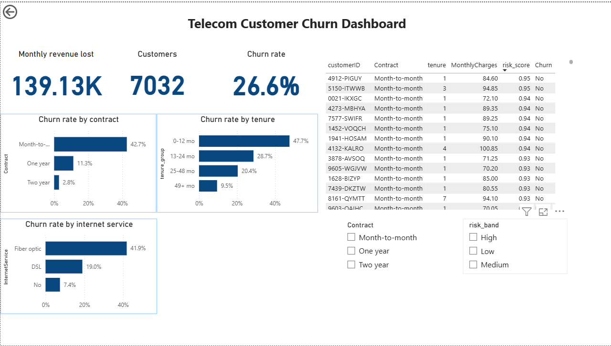
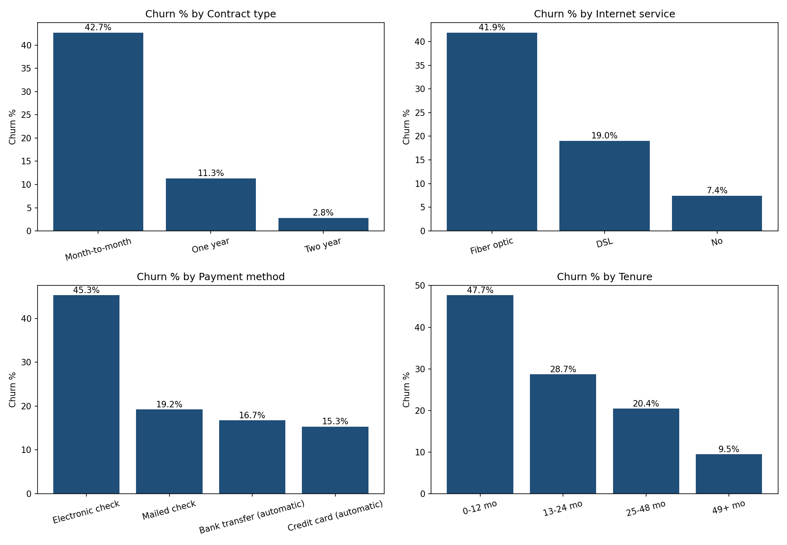
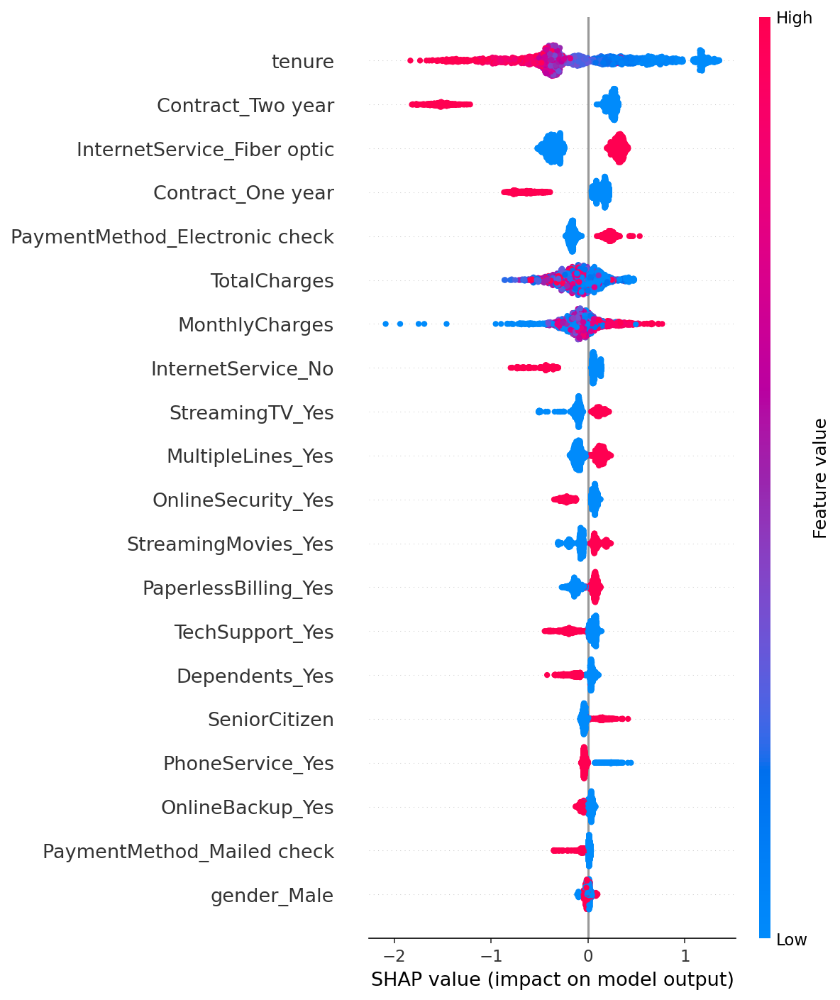

# Telecom Customer Churn Analysis

## Business question
Which customers are most likely to leave, why, and how much revenue is at risk?

## Key findings
- **26.6% of customers churned** (1,869 of 7,032), worth about **$139K in monthly revenue (30.5% of the total)**, or roughly $1.67M a year.
- **Contract type:** month-to-month customers churn at 42.7%, compared with 11.3% (one year) and 2.8% (two year).
- **Tenure:** churn is 47.7% in the first 12 months and falls to 9.5% for customers with 49+ months.
- **Internet service:** fiber optic customers churn at 41.9%, against 19.0% for DSL.
- **Payment method:** electronic check customers churn at 45.3%, against 15.3% for credit card (automatic).
- **Price:** customers who left paid more per month on average ($74.4 vs $61.3).
- The riskiest active customers are new month-to-month customers on high monthly charges.

## Model
| Model | Precision | Recall | ROC-AUC |
|---|---|---|---|
| Logistic Regression | 0.490 | 0.794 | 0.835 |
| Random Forest | 0.546 | 0.746 | 0.836 |
| XGBoost | 0.493 | 0.797 | 0.837 |

I chose **XGBoost** because it catches the most churners (79.7% recall), accepting more false alarms. SHAP analysis shows tenure, contract type, fiber optic service and electronic check payment as the strongest drivers, matching the SQL findings.

## Business impact (simulation)
On the test set (1,407 customers), assuming a retention offer saves 30% of churners for 12 months, targeting model-flagged customers beat offering to everyone once the offer cost passed about $20, and stayed profitable at $100 per offer when blanket offers lost money. The success rate and duration are assumptions, not measured results.

## Dashboard

## Charts

## Tools
Python (pandas, scikit-learn, XGBoost, SHAP, matplotlib), SQL (SQLite), Power BI

## Method
1. Cleaned the data: 11 blank TotalCharges values (all new customers with 0 tenure) were removed, leaving 7,032 customers.
2. Analysed churn drivers with SQL queries and charts.
3. One-hot encoded categories, split 80/20 (stratified), and scaled numeric features using training data only.
4. Compared three models using recall, precision and ROC-AUC, since only about 27% of customers churn.
5. Built a Power BI dashboard with a list of active customers ranked by churn risk.

## Limitations
- The data is from one public dataset (no currency stated; $ used here).
- Results show association, not cause.
- Risk scores are a ranking, not exact probabilities, because the models were weighted toward catching churners.
- The business impact figures depend on assumptions.
- Risk scores were calculated on all customers, including those used to train the model, so the churn rate inside the "High" band is optimistic.

## Data source
Telco Customer Churn dataset on Kaggle.
